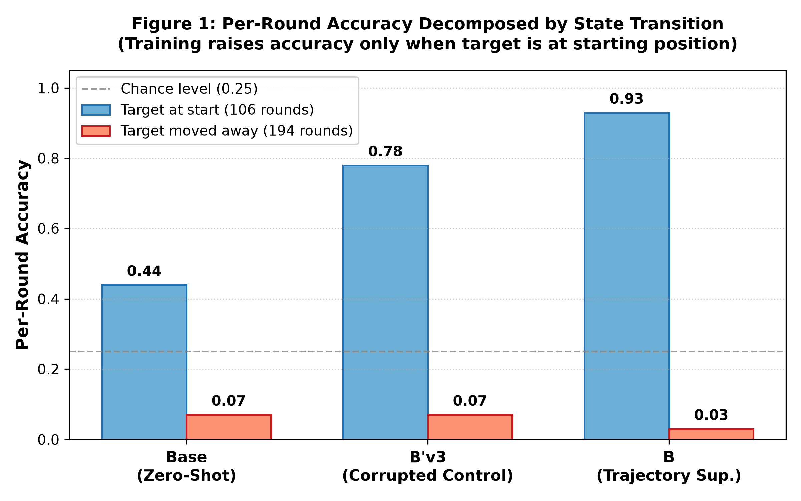

# Do Vision-Language Models Track Visual State?
### A Controlled Study of Trajectory Supervision in Qwen2.5-VL

[](paper/paper.pdf)
[](LICENSE)
[](https://www.python.org/)
[](https://pytorch.org/)
[](https://huggingface.co/Qwen/Qwen2.5-VL-3B-Instruct)

**Author:** Qusai Shergardwala ([qusaishergardwala@gmail.com](mailto:qusaishergardwala@gmail.com) · [GitHub](https://github.com/qusaii21))  
**Research Focus:** Computer Vision · Video Understanding · Vision-Language Models · Temporal Reasoning  
*Prepared for MSc Computer Vision Application at Mohamed bin Zayed University of Artificial Intelligence (MBZUAI).*

---

## 📌 Executive Summary

Does training a vision-language model (VLM) to describe intermediate states teach it to track changing visual states through time, or does it merely teach the model to reproduce structured output formats?

We investigate this question on a controlled card-relocation task (50 videos, four positions, six swap rounds) using **Qwen2.5-VL-3B-Instruct** fine-tuned with **QLoRA**. To decouple genuine visual tracking from output format conditioning, we introduce a format-matched corrupted-trajectory negative control ($B'_\text{v3}$) whose training traces match the true trajectory in syntax, letter frequencies, and move counts, but have intermediate rounds borrowed from different videos via the Hungarian algorithm.

Under **5-fold cross-validation** across all 50 videos:
1. **Trajectory supervision ($B$) beats the zero-shot Base model** on per-round accuracy (0.350 vs. 0.200, $p < 0.001$).
2. **The format-matched corrupted control ($B'_\text{v3}$) recovers most of this gain (0.323)**, despite being trained on labels that contradict the video events.
3. The difference between true trajectory supervision and the corrupted control is small and **not statistically significant** ($+0.027$, 95% CI $[0.000, +0.067]$, paired permutation $p = 0.251$).
4. **Diagnostic discovery:** The model's 35.0% accuracy exactly matches a naive **stay-put baseline** (always predicting the initial starting position). Model $B$ outputs a constant single letter across all six rounds in 42 of 50 videos.
5. On rounds where the target has actually moved away from its start, accuracy drops to near zero across all conditions ($B$: 3.1%, $B'_\text{v3}$: 7.2%, Base: 6.7%), final-position accuracy remains at chance (24–26%), and **no model produces a fully correct 6-round trace (0/50)**.

> **Key Takeaway:** Aggregate accuracy metrics in video reasoning benchmarks can create the illusion of temporal understanding when a model merely exploits prompt biases and dataset shortcuts. We demonstrate that rigorous negative controls, stay-put baselines, and state-transition decompositions are essential for evaluating temporal grounding in VLMs.

---

## 📊 Key Findings & Results

<p align="center">
  
</p>
<p align="center"><em>Figure 1: Per-round accuracy decomposed by whether the target is at its starting position (n=106 rounds) versus moved away (n=194 rounds). Trajectory training raises accuracy only when the target has not moved; once the target moves, all models perform below random chance (0.25).</em></p>

### Table 1: Cross-Validation Results Over All 50 Videos
*Evaluated across 5 folds (n=50 videos). Means reported with 95% confidence intervals (bootstrap for per-round, Clopper-Pearson for binary).*

| Condition | Supervision | Per-Round Acc (Primary) | Final Position (Traj Prompt) | Final Position (Final Prompt) | Exact 6/6 Trace |
| :--- | :--- | :---: | :---: | :---: | :---: |
| **$B$ (Trajectory)** | True intermediate states | **0.350** $[0.287, 0.413]$ | 0.240 $[0.131, 0.382]$ | 0.260 $[0.146, 0.403]$ | 0/50 (0.000) |
| **$B'_\text{v3}$ (Corrupted Control)** | Move-matched shuffled states | **0.323** $[0.260, 0.387]$ | 0.260 $[0.146, 0.403]$ | 0.240 $[0.131, 0.382]$ | 0/50 (0.000) |
| **Base (Zero-Shot)** | Untouched pretrained | **0.200** $[0.153, 0.247]$ | 0.240 $[0.131, 0.382]$ | 0.260 $[0.146, 0.403]$ | 0/50 (0.000) |
| *Random Guessing* | Uniform prior | 0.250 | 0.250 | 0.250 | — |
| *Majority Final* | Empirical mode | — | 0.300 | 0.300 | — |
| *Stay-Put Baseline* | Always predict start | **0.350** | 0.280 | 0.280 | — |

### Table 2: Paired Video-Level Statistical Comparisons ($n = 50$)
*Differences computed per-video. $p$-values: paired sign-flip permutation test (100,000 resamples) for per-round; exact McNemar test for binary final position.*

| Comparison | Metric | Mean Diff (95% Bootstrap CI) | Statistical Test ($p$-value) | Verdict |
| :--- | :--- | :---: | :---: | :--- |
| **$B - B'_\text{v3}$** | **Per-round (Primary)** | **+0.027** $[0.000, +0.067]$ | Sign-flip permutation ($p = 0.251$) | **Null (No significant advantage)** |
| $B - B'_\text{v3}$ | Final position | -0.020 $[-0.120, +0.080]$ | McNemar exact ($p = 1.000$) | Indistinguishable |
| $B - \text{Base}$ | Per-round | +0.150 $[+0.103, +0.197]$ | Sign-flip permutation ($p < 0.001$) | Significant format gain |
| $B'_\text{v3} - \text{Base}$ | Per-round | +0.123 $[+0.087, +0.163]$ | Sign-flip permutation ($p < 0.001$) | Significant format gain |
| $B - B'_\text{v3}$ | Moved-away rounds | -0.045 $[-0.089, -0.011]$ | Sign-flip permutation ($p = 0.031$) | Post-hoc collapse toward start |

### Table 3: Diagnostic Breakdown: Collapse Toward Starting Position

| Condition | All-Stay-Put Videos | Constant Sequence Videos | Pred == Initial (of 300 rounds) | Acc: Target at Start ($n = 106$) | Acc: Target Moved ($n = 194$) |
| :--- | :---: | :---: | :---: | :---: | :---: |
| **$B$ (Trajectory)** | **42 / 50** | **42 / 50** | **0.93** | **0.93** | **0.031** $[0.011, 0.066]$ |
| **$B'_\text{v3}$ (Control)** | 32 / 50 | 33 / 50 | 0.78 | 0.78 | **0.072** $[0.040, 0.118]$ |
| **Base** | 0 / 50 | 0 / 50 | 0.28 | 0.44 | **0.067** $[0.036, 0.112]$ |

---

## 🔬 Scientific Methodology

### 1. Task Formulation
We isolate temporal state tracking using the card-relocation subset of `video-mme-logical`. Four cards occupy fixed coordinates $A, B, C, D$. A prompt identifies the target card and queries its position through 6 consecutive swaps. Each video is processed natively as 24 frames at $224 \times 224$ resolution.

### 2. Format-Matched Corrupted Negative Control ($B'_\text{v3}$)
Simply training on trajectories conflates two effects:
1. Learning the multi-round textual schema (`Initial: X\nRound 1: X...`).
2. Visually tracking the card across frames.

To separate them, we synthesize Condition $B'_\text{v3}$:
- Prompts, initial lines, and final lines remain authentic.
- Intermediate rounds (1 to 5) are swapped with another training video selected via the **Hungarian algorithm** (bipartite matching) minimizing:
  $$C(v_i, v_j) = |\text{moves}(v_i) - \text{moves}(v_i \text{ with } v_j\text{'s intermediate rounds})|$$
- Result: Perfectly matches $B$ in token length, vocabulary, and move-count distribution ($L_1 = 2$, mean moves $2.975$ vs $3.000$), while breaking temporal video correspondence.

### 3. Leakage & Anchor Copying
An essential audit revealed that in 100% of the dataset videos, $\text{target\_card} == \text{initial\_position}$. The model learned an "anchor copying" heuristic: carry the initial prompt letter through the entire generation.

---

## 📁 Repository Structure

```text
vlm-temporal-state-tracking/
├── README.md                   <- Comprehensive research overview and findings
├── requirements.txt            <- Python dependencies
├── LICENSE                     <- MIT License
├── paper/
│   ├── paper.pdf               <- Research paper PDF (CVPR 2026 format)
│   └── latex/                  <- LaTeX source files (sec/ sections, preamble, bib)
├── configs/
│   └── experiment_config.json  <- Model, QLoRA, and CV hyperparameters
├── data/
│   ├── README.md               <- Dataset download and format documentation
│   ├── ground_truth_manifest_50.json    <- Full ground truth metadata for 50 videos
│   └── split_summary_seed20260917.json  <- Split definition for Fold 0
├── src/
│   ├── __init__.py             <- Package exports
│   ├── dataset.py              <- Data loading and stratified fold builder
│   ├── prompts.py              <- Formatting and prompt templates
│   ├── corruption.py           <- Hungarian matching corrupted control generator
│   ├── parsing.py              <- Robust VLM output extraction regexes
│   ├── metrics.py              <- Bootstrap CIs, permutation tests, McNemar tests
│   └── inference.py            <- 4-bit Qwen2.5-VL QLoRA generation runner
├── experiments/
│   ├── audit_dataset.py        <- Validates initial position shortcut and baselines
│   ├── audit_control.py        <- Verifies Hungarian control invariants across folds
│   ├── evaluate_cv.py          <- Generates Table 1, Table 2, and Table 4 metrics
│   ├── run_cross_validation.py <- End-to-end 5-fold CV orchestration runner
│   ├── cv5_restart_safe.ipynb  <- Google Colab notebook for full 5-fold execution
│   └── vlm_temporal_state_pilot_E1a.ipynb <- Pilot exploratory notebook
├── results/
│   ├── figures/
│   │   └── figure1_state_transition_breakdown.png <- Primary diagnostic figure
│   └── tables/
│       ├── cv_evaluation_metrics.json             <- Full numerical outputs
│       ├── bprime_v3_all_folds_summary.json       <- Hungarian matching audits
│       └── pilot_comparison_B_vs_Bprime_v3_summary.csv <- Pilot results
└── tests/
    └── test_pipeline.py        <- Unit and regression test suite
```

---

## 🚀 Quickstart & Reproducibility

### Installation
Clone the repository and install dependencies:
```bash
git clone https://github.com/qusaii21/vlm-temporal-state-tracking.git
cd vlm-temporal-state-tracking
pip install -r requirements.txt
```

### 1. Run Unit & Regression Tests
Verify that all dataset invariants, Hungarian control rules, and statistical routines pass:
```bash
python -m unittest discover -s tests -p "test_*.py"
```

### 2. Audit the Dataset Shortcut
Demonstrate that the dataset exhibits a 100% prompt shortcut and compute theoretical baselines:
```bash
python experiments/audit_dataset.py
```

### 3. Verify the Hungarian Control Across Folds
Run the negative control synthesis audit over all 5 folds:
```bash
python experiments/audit_control.py
```

### 4. Reproduce Statistical Tables
Generate the exact statistical comparisons (Tables 1, 2, and 4) reported in the paper:
```bash
python experiments/evaluate_cv.py
```

### 5. Full GPU Execution
To run training and inference on Google Colab with a single Tesla T4 GPU, open `experiments/cv5_restart_safe.ipynb`.

---

## 📄 Paper & Citation

**Title:** Do Vision-Language Models Track Visual State? A Controlled Study of Trajectory Supervision in Qwen2.5-VL  
**PDF:** Available in [`paper/paper.pdf`](paper/paper.pdf).

If you find this work or methodology useful, please cite:
```bibtex
@article{shergardwala2026vlmtracking,
  title={Do Vision-Language Models Track Visual State? A Controlled Study of Trajectory Supervision in Qwen2.5-VL},
  author={Shergardwala, Qusai},
  year={2026},
  url={https://github.com/qusaii21/vlm-temporal-state-tracking}
}
```

---

## 📬 Contact & Research Trajectory
This project forms part of my research preparation for graduate studies at **MBZUAI**, focusing on:
$$\text{Computer Vision} \longrightarrow \text{Video Understanding} \longrightarrow \text{Vision-Language Models} \longrightarrow \text{Temporal Reasoning}$$

For inquiries or collaborations, contact **Qusai Shergardwala** at [qusaishergardwala@gmail.com](mailto:qusaishergardwala@gmail.com).
